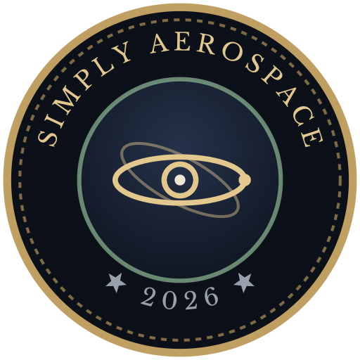

# Change log — Simply Aerospace website

Every version of https://mcsyme11-byte.github.io/SimplyAerospace/, newest first. Semantic versioning (MAJOR.MINOR.PATCH); the footer build stamp shows the current one. Every release adds a `## vX.Y.Z` section here (the Site check fails without it).

## v3.1.2 — 2026.11.19
- **Branding everywhere in the repo:**
  - every document starts with the mission patch and ends with the credit and trademark line;
  - every code and config file carries "© Malcolm Syme · mcsyme11@gmail.com";
  - the site's source opens with a copyright notice.
- **Credit inside the images:** every PNG (icons, share preview, patch) has the credit embedded in its file details (Author, Copyright). The pixels are unchanged.
- New `brand/simply-aerospace-patch-512.png` (the full patch, used at the top of the docs).
- **The Site check now enforces branding**, so a new file without the credit, a document without the patch, or an image without the embedded credit fails the check.

## v3.1.1 — 2026.11.17
- **Footer formatting fixed:**
  - the brand text and link columns are left-aligned (they were centred);
  - the Begley quote is centred properly, with its credit under it;
  - the credit and trademark lines sit on the left of a bottom row.
- **Version line redesigned:** the glowing "SIMPLY AEROSPACE / V3.1.0 / … / LIVE" badge is now a quiet line: "● Version 3.1.1 · Updated Nov 17, 2026 · 24 explainers". The exact build stays in the tooltip.
- **Instagram and YouTube** are small outlined buttons with ↗.
- **Tablet and phone layout:** three link columns on tablets, two on phones, and room for the back-to-top button so it no longer covers the version line.

## v3.1.0 — 2026.11.17
- **Fixed:** the top bar now stays at the top while scrolling. Before, it scrolled away and the reading-progress bar floated on its own: `overflow-x: hidden` on both `html` and `body` made the page body its own scroll box, which stops "sticky" from working, so it is now `overflow-x: clip`.
- **Reading progress** is attached to the bottom edge of the top bar. It moves with `transform` only, so scrolling stays smooth.
- **The top bar darkens** slightly, with a brighter brass line, once the page is scrolled.
- **Myth ticker** on Home: every myth the channel has busted scrolls past, crossed out, with the explainer's code. Each one links to its explainer; the ticker pauses on hover or focus, and stands still when "reduce motion" is on.
- **The hero patch's orbit dot** now really orbits the centre ring (it stands still with "reduce motion").
- **Back-to-top button** with a brass ring that fills as you read.
- **Card spotlight:** a soft brass light follows the pointer across cards (mouse only; off with "reduce motion").
- **Mission Control promo:** a slowly turning orbit with a brass dot around the mission count.
- **Ctrl K / ⌘K** opens search from anywhere, and is listed in the shortcuts help (`?`).

## v3.0.0 — 2026.11.17
- **New look:** the shared "old money" design of Malcolm Syme's projects:
  - navy, brass and cream, with Georgia throughout;
  - thin brass rules, pill buttons, and cards whose border turns brass.
- **No web fonts:** the Google Fonts download is gone, so pages load faster and nothing is requested from other companies.
- **The patch's gold is the shared brass** (`#C0A062` / `#E2C88E`), like the other projects' patches. The icons and share preview were rebuilt.
- **Faster to get around:**
  - a sticky top bar with direct links (Explainers, Myths, Mission Control, Glossary) and a More menu;
  - search on every page (`/`), and a full-screen menu on phones;
  - the current page highlighted, a back-to-top button, and a skip link.
- **New "All explainers" page** (`#/explainers`): filter by topic and level, and narrow down by any word.
- **Home:**
  - the hero has the patch, "Browse all explainers" and "Find your level", topic shortcuts and "Surprise me";
  - a **Mission Control** promo card.
- **New Legal page** (`#/legal`): terms of use, privacy (what the site stores in your browser), copyright and trademarks, contact.
- **New footer:** the patch, Explore / Learn / About columns, the Begley quote, the build stamp, the credit and trademark lines, and a link to Legal.

## v2.8.0 — 2026.11.17
- **The mission patch is the logo.** No-text patch in the top bar, full patch in the home hero (inline SVG, lettering outlined), tiny version as the favicon.
- New icons: `favicon.svg`, `favicon.ico`, `apple-touch-icon.png`, `icon-192.png`, `icon-512.png`, `site.webmanifest`; new share preview `og-image.png`.
- Footer credit: © Malcolm Syme · mcsyme11@gmail.com · Simply Aerospace™.
- Repo: rules for Claude (`CLAUDE.md`), design guide (`docs/DESIGN.md`), release checklist (`docs/RELEASE-CHECKLIST.md`), this change log, and the automatic **Site check** on every push.

## v2.7.0 — 2026.10.23
- Mission Control rebuilt as multi-stage missions (briefing → decision stages with consequences → debrief), expanded from 4 to **8 missions**; patches saved in the visitor's browser.

## v2.6.0 — 2026.10.22
- New explainers: tides (`SP·11`, Flight), rocket landing (`PR·05`, Senior). **24 explainers.**
- **Mission Control** launched (4 missions).
- Fixed a duplicate in the coming-soon list.

## v2.5.0 — 2026.10.14
- New explainers: ion engine (`PR·04`, Senior), seasons (`SP·10`, Junior).
- Search also finds glossary terms, with the definition inline and a link to the term.

## v2.4.0 — 2026.10.07
- New explainers: black hole, helicopter, paper airplane. **20 explainers.**

## v1.x – v2.3 — 2026
- Initial build: core pages, brand, the first ~17 explainers, and the site features (difficulty filter, search, quiz, glossary, stat strips, keyboard shortcuts, watched tracking, social previews).

---
© 2026 Malcolm Syme · mcsyme11@gmail.com · Simply Aerospace™ and the Simply Aerospace mission patch are trademarks of Malcolm Syme.
