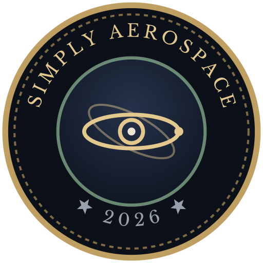

# Simply Aerospace — website

**Aerospace, explained simply.** The companion website of Malcolm Syme's Simply Aerospace channel: every explainer as an article (myth, truth, the concept, sources), plus the Myth Index, Levels, Quiz, Glossary and Mission Control for younger visitors.

**Live:** https://mcsyme11-byte.github.io/SimplyAerospace/ (GitHub Pages, from `main`).

| File | What it is |
|---|---|
| `index.html` | The whole site in one file: markup, styles, script and content data |
| `og-image.png` | Share preview |
| `favicon.*`, `apple-touch-icon.png`, `icon-*.png`, `site.webmanifest` | Icons |
| `CHANGELOG.md` | Every version |
| `CLAUDE.md` | Rules for Claude when working on the site |
| `docs/DESIGN.md` | Design guide |
| `docs/RELEASE-CHECKLIST.md` | The steps for every release |
| `tools/check_site.js` | The Site check, run automatically on every push |

**License:** all rights reserved. See [LICENSE.md](LICENSE.md).

---
© 2026 Malcolm Syme · mcsyme11@gmail.com · Simply Aerospace™ and the Simply Aerospace mission patch are trademarks of Malcolm Syme.
